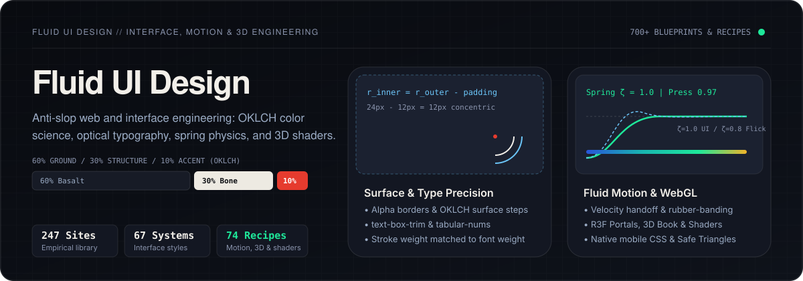
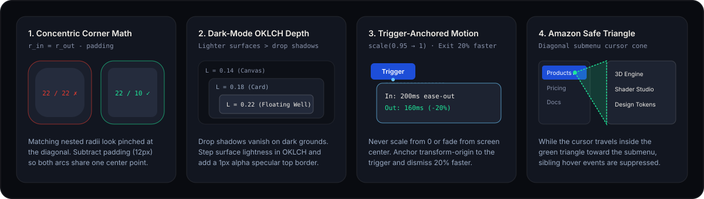
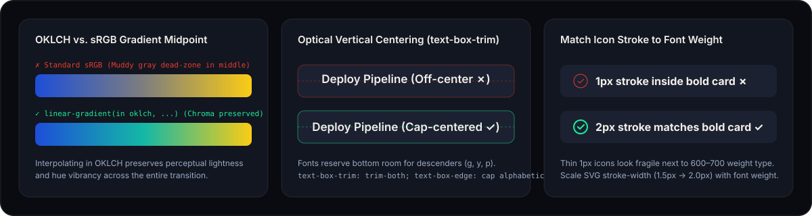
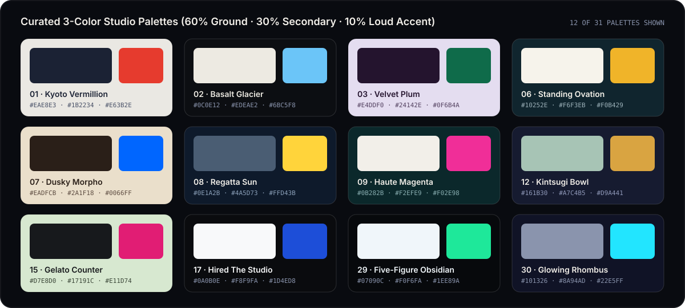
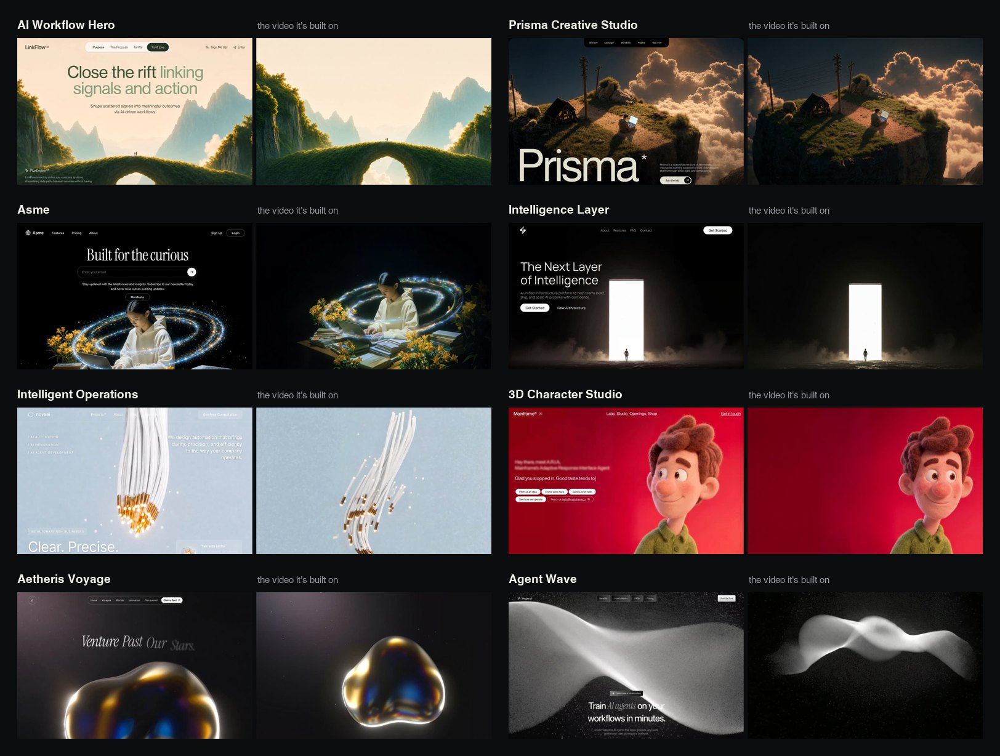
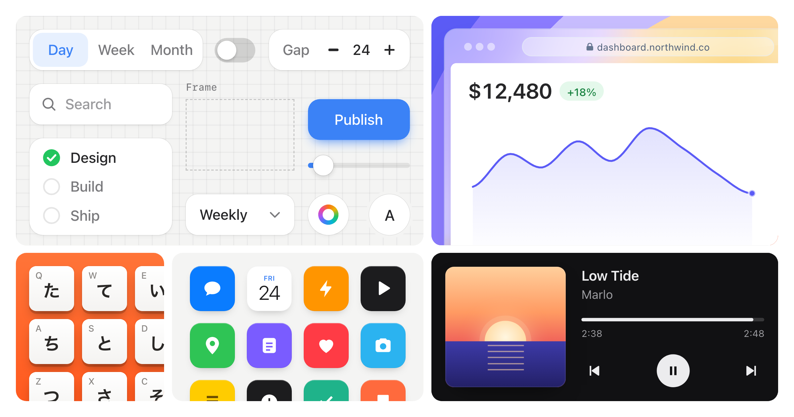
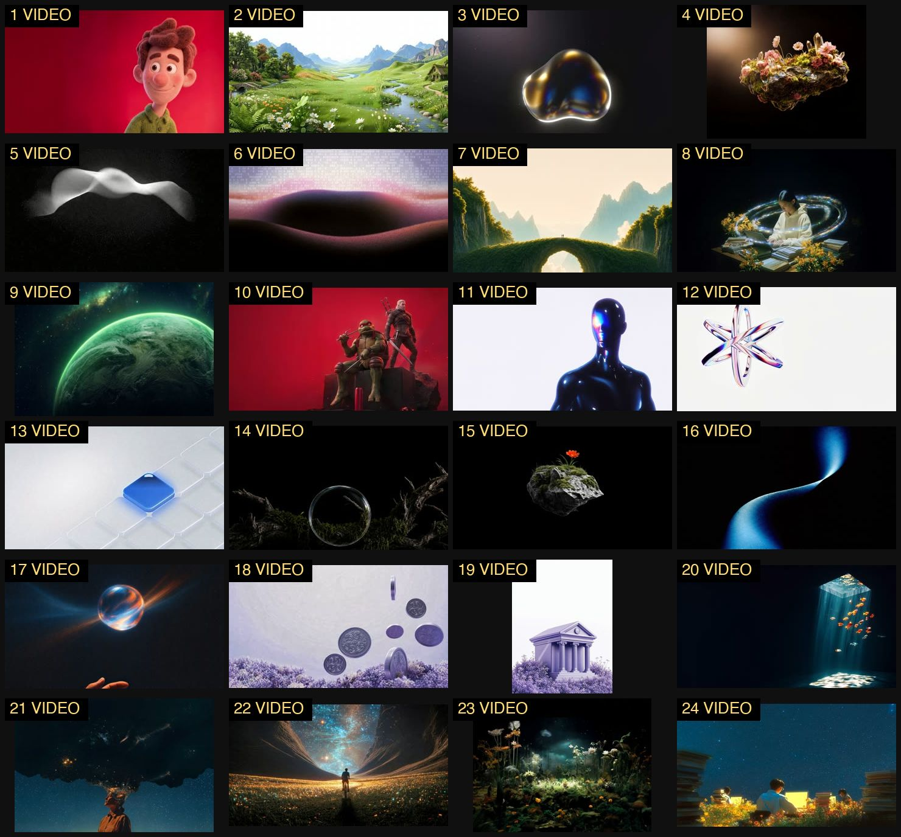

# Fluid UI Design



A web, interface, motion, and 3D engineering skill for **Codex, Claude Code, Cursor, and Antigravity**.

Unconstrained models build the average of their training corpus: a centered headline with one italicized word, an eyebrow badge above every section, `Geist` or `Instrument Serif`, three bordered icon cards, and muddy sRGB gradients. **Fluid UI Design** replaces those defaults with concrete geometry, perceptual color math (`OKLCH`), optical typography, velocity-aware spring physics, WebGL/3D architectures, and a real-browser inspection gate.

The core rules and reference blueprints require no external runtime or API key. Optional local scripts deal empirical layout directions (`Node 18+`), fetch open-archive imagery, and measure rendered layouts in headless Chrome (`Node 22+`) or Playwright.

---

## Why choose Fluid UI Design?

Choose it when generated pages or application screens need specific engineering decisions rather than generic decoration:

- **Eliminate AI-slop tells systematically.** Bans default model fonts (`Geist`, `Space Grotesk`, `Bricolage Grotesque`, `Instrument Sans/Serif`, `JetBrains Mono`), random italicized headline words, `[ 01 / OVERVIEW ]` indices, sparkle badges, and nested border clutter in favor of studio grotesks (`Switzer`, `ABC Diatype`, `TWK Lausanne`, `PP Mori`, `Aeonik`, `GT Walsheim`) and spatial grouping.
- **Compute geometry and surfaces accurately.** Enforces concentric corner radii (`r_inner = r_outer - padding`), translucent alpha borders, dark-mode depth via `oklch()` surface lightness steps instead of invisible black drop shadows, SVG stroke weights matched to font weight, carousel edge masks, and `mix-blend-mode: multiply` for white-background product shots.
- **Design color in perceptual `OKLCH` space.** Includes **31 curated 3-color studio palettes** built on the 60–30–10 proportion (*two calm tones so the third can speak*), `linear-gradient(in oklch, ...)` interpolation to avoid gray midpoints, rules for resolving chroma competition, and compensation for 16 perceptual phenomena (*simultaneous contrast, irradiation illusion, Helmholtz–Kohlrausch, Abney, Hunt*).
- **Apply Apple-grade fluid motion and native mobile CSS.** Translates WWDC *Designing Fluid Interfaces* into web primitives: pointer-down `scale(0.97)` feedback, trigger-anchored popovers (`scale(0.95 → 1)`), exits 20% faster than entrances, critically damped springs (`ζ = 1.0`) vs. momentum flick springs (`ζ = 0.8`), progressive rubber-banding, `interpolate-size: allow-keywords` accordions, `100dvh`, `16px` mobile inputs, `inputmode="numeric"`, `autocomplete="one-time-code"`, and Amazon Safe Triangles.
- **Draw from 800+ empirical blueprints, style systems, product-UI demos, and 3D recipes.** Combines data from **247 studied Awwwards and One Page Love sites** (`library/`), **69 Stageshow product-UI scenes and cursor demos** (`stageshow/`), **67 design systems** (`styles/`), **40 full hero/page prompts** (`examples/`), **50+ public video loops and 30 cutouts** (`media/`), and **74 motion, shader, and Three.js/WebGL recipes** (`references/techniques/` and `blueprints/`).
- **Measure the render in a real browser.** `scripts/lint.mjs` scans source code for stock patterns; `scripts/inspect.mjs` renders the page at `1440px`, `768px`, and `390px` over the Chrome DevTools Protocol to verify two-line headlines, outer margin symmetry, contrast, and zero layout collapse; `stageshow/scripts/film.mjs --gate` films multi-frame contact sheets of scripted UI demos to catch layout jumps and loop seams before delivery.
- **Code against browser guidance.** The [bundled Modern Web Guidance CLI](references/web-platform.md) retrieves implementation guides and Baseline fallback advice before you choose web APIs.
- **Study web references by URL.** The [URL study](references/url-reference-study.md) runs TypeUI for DESIGN.md and SKILL.md and collects responsive and motion evidence with DesignLang when installed.
- **Measure performance before and after.** The [Chrome Lighthouse workflow](references/web-performance.md) measures a served page under matching mobile settings and reports how LCP, layout stability, startup blocking, and transfer size changed.

---

## Runnable example

[Field Signal](blueprints/field-signal/index.html) is an oscilloscope with drag and keyboard controls, waveform morphing, and a sweep you can pause and resume. Open the HTML file from a local checkout. [Motion implementation notes](references/motion-composition.md)

The [reference component library](blueprints/reference-components/README.md) links runnable demos to the clips and websites they came from. Open a drawer, replay an animation, change a selected state, or inspect the component code. It includes Chrome checks at desktop and mobile widths.

## CSS examples

**Before (typical model default)**

```css
/* Matching nested radii pinch at the diagonal; sRGB gradient turns muddy gray in the middle;
   black shadow vanishes on dark cards; 14px input forces iOS Safari to auto-zoom on tap. */
.card {
  background: #121212;
  border: 1px solid #2a2a2a;
  border-radius: 20px;
  padding: 12px;
  box-shadow: 0 12px 32px rgba(0, 0, 0, 0.6);
  transition: all 0.3s ease;
}
.card-media {
  border-radius: 20px;
  background: linear-gradient(135deg, #2563eb, #facc15);
}
.input { font-size: 14px; height: 100vh; }
```

**After (Fluid UI Design)**

```css
/* Concentric inner radius (20px - 12px = 8px); dark-mode elevation via OKLCH lightness + alpha specular edge;
   OKLCH gradient interpolation preserves midpoint chroma; compositor-only transform; iOS-safe 16px input & 100dvh. */
.card {
  --r-outer: 20px;
  --pad: 12px;
  background: oklch(0.18 0.01 260);
  border: 1px solid oklch(1 0 0 / 0.09);
  border-top-color: oklch(1 0 0 / 0.20);
  border-radius: var(--r-outer);
  padding: var(--pad);
  transition: transform 140ms cubic-bezier(0.22, 1, 0.36, 1);
}
.card:active { transform: scale(0.97); }
.card-media {
  border-radius: max(4px, calc(var(--r-outer) - var(--pad)));
  background: linear-gradient(135deg in oklch, oklch(0.55 0.22 264), oklch(0.86 0.18 92));
}
.input { font-size: max(16px, 1rem); min-height: 48px; touch-action: manipulation; }
```

---

## Visual Reference Plates







---

## How the workflow runs

1. **Inventory and argument.** List 8–12 specific facts that belong to this subject and no competitor (its materials, street, output, constraint, or artifacts), and write the page's argument as one claim per section.
2. **Deal an empirical direction or style.** Run `node scripts/draw.mjs --sector <sector> --brief "<subject>" --sections ... --options 3` to deal three directions from the 247-site library (or `--app` for dashboards and workspaces), or select one of the 67 design systems in [`styles/INDEX.md`](styles/INDEX.md).
3. **Source authentic media.** Start with project-owned assets, or search open archives with `node scripts/assets.mjs "<query>"` and retain the license record. Check individual file permissions before using a reference from the [media shelf](media/MEDIA.md).
4. **Build with one signature and fluid physics.** Implement the token system first, build one interactive live element native to the subject, and add one signature motion or 3D technique from [`references/techniques/INDEX.md`](references/techniques/INDEX.md).
5. **Gate and visual critique.** Run `node scripts/lint.mjs` and `node scripts/inspect.mjs` (at `1440px`, `768px`, and `390px`), open the saved screenshots, score them against [`references/critique.md`](references/critique.md), fix every `FAIL` and the top three visual weaknesses, and re-run until clean.

**For a first build**, pick one [DESIGN.md reference](references/design-library/INDEX.md) based on the brief and the strongest product image, footage, or illustration you have. The [reference workflow](references/design-reference-workflow.md) covers media rights, MotionSites MCP and browser checks. Open the [motion demo](blueprints/design-motion-studies.html) or choose from the [original background loops](media/loops/README.md).

For interactive controls, [motion composition](references/motion-composition.md) pairs reusable mechanisms with [twelve MIT Bencho components](blueprints/bencho/README.md) and an original 3D material study.

[Component sources](blueprints/component-sources/index.html) searches Uiverse, ForgeUI and Uilora by category and framework. Browse the [source selection guide](references/component-sourcing.md) for licensing, imports and testing.

[Pinned motion-library sources](vendor/motion-sources/README.md) gives local lookup paths, integration guidance and upstream revisions for Anime.js, GSAP, Lenis and React Bits. The [Anime.js guide](references/animejs.md) and [workbench](blueprints/animejs/index.html) cover custom timelines, SVG drawing, drag, layout, scroll, text and pointer-driven animation.

[Mobile interfaces](references/mobile-platforms.md) distinguishes responsive web from native SwiftUI. The [four-style control study](blueprints/mobile/control-styles.html) shares one dial across three input paths. [Public-preview recipes](references/public-preview-recipes.md) link to four original background videos and their source.





---

## What it integrates and how it compares

This package synthesizes several specialized design repositories and engineering references into one installable skill:

| Integrated source / domain | What it contributes here |
| --- | --- |
| **Empirical 247-site study (`tasteskill v2`)** | `library/*.json` (20 directions, 100+ hero/section/app blueprints, 247 site analyses) + `scripts/draw.mjs`, `lint.mjs`, `inspect.mjs`, `scenes.mjs`, `assets.mjs`, and `evals/evals.json` |
| **Faux Product UI & Cursor Demos (`stageshow` + `stageshow-js`)** | [`stageshow/`](stageshow/SKILL.md) (Benji Taylor's complete product-UI illustration engine: 69 gold & product-study scenes, `stageshow/kit/` React primitives, `stageshow/vanilla-runtime/` plain-JS exporter, 15 framing/choreography references, 9 bad/good teaching pairs, and `film.mjs --gate` rehearsal tool) |
| **Cinematic web specs (`motionsites-web-builder`)** | [`examples/`](examples/INDEX.md) (40 full hero/landing build prompts), [`media/`](media/MEDIA.md) (50+ video loops, 30 cutouts, contact sheets), 58 motion recipes, and `scripts/shoot.py` (with commercial ads stripped) |
| **67 Interface Style Guides (`awesome-design-skills`)** | [`styles/`](styles/INDEX.md) (`agentic`, `bento`, `brutalism`, `claymorphism`, `dithered`, `editorial`, `glassmorphism`, `minimal`, `neobrutalism`, `riso`, `shadcn`, `skeumorphism`, etc.) |
| **Apple Fluid Interfaces & Web Guidelines** | [`references/apple-fluid-interfaces.md`](references/apple-fluid-interfaces.md) (WWDC spring physics, momentum projection, velocity handoff, rubber-banding) & [`references/web-interface-guidelines.md`](references/web-interface-guidelines.md) |
| **Color Science, Optical Type & UX Laws** | [`references/palettes-and-aesthetics.md`](references/palettes-and-aesthetics.md) (31 palettes, 20 historical eras, 22 textures), [`references/typography-and-geometry.md`](references/typography-and-geometry.md), [`references/motion-mobile-and-ux-patterns.md`](references/motion-mobile-and-ux-patterns.md) (22 UX laws, Safe Triangles, Optimistic UI, Idempotency) |
| **3D, Portals & Shaders (`Three.js` / `R3F` / `WebGPU`)** | [`references/techniques/3d-portals-shaders-and-webgl.md`](references/techniques/3d-portals-shaders-and-webgl.md) & [`blueprints/`](blueprints/) (`inside-the-microchip-3d.html`, `animated-book-slider-Book.jsx`, `shadcn-v4-copy-button.tsx`, `MeshPortalMaterial`, `react-reverse-portal`, `Paper Shaders`, `Glisse`, `Three-Geospatial`, `Pokemon Cards CSS`, `ShaderGradient`) |

Read [`BACKGROUND.md`](BACKGROUND.md) for the empirical findings from the 247-site study, why models fall into templated defaults, and the boundary between automated DOM checks and visual screenshot critique.



---

## Install with Git

Choose the destination for your client:

**Linux, macOS, or WSL:**

```sh
# Codex
git clone --depth 1 https://github.com/Oskarhn/fluid-ui-design.git "$HOME/.agents/skills/fluid-ui-design"

# Claude Code
git clone --depth 1 https://github.com/Oskarhn/fluid-ui-design.git "$HOME/.claude/skills/fluid-ui-design"
```

**Windows PowerShell:**

```powershell
# Codex / Shared Agent Skills
git clone --depth 1 https://github.com/Oskarhn/fluid-ui-design.git "$HOME\.agents\skills\fluid-ui-design"

# Claude Code
git clone --depth 1 https://github.com/Oskarhn/fluid-ui-design.git "$HOME\.claude\skills\fluid-ui-design"

# Google Antigravity
git clone --depth 1 https://github.com/Oskarhn/fluid-ui-design.git "$HOME\.gemini\config\skills\fluid-ui-design"
```

### Update

From the installed `fluid-ui-design` directory:

```sh
git pull --ff-only
```

---

## Try it

- *"Use fluid-ui-design to build a landing page for an autonomous maritime navigation system. Use the Regatta Sun or Basalt Glacier OKLCH palette, one live interactive telemetry control, and verify with inspect.mjs."*
- *"Audit and refactor our React dashboard with fluid-ui-design: fix nested corner radii, replace drop shadows with OKLCH surface lightness steps, add tabular numerals, and make mobile inputs native."*
- *"Build an interactive 3D product showcase using React Three Fiber with Drei MeshPortalMaterial cards or a 30-bone SkinnedMesh page turner."*
- *"Write a detailed build prompt for Lovable / v0 using a Dieter Rams Braun or NASA 1975 Graphic Manual aesthetic."*

---

## License

[MIT License](LICENSE). Bundled style references, open-archive imagery fetched via `assets.mjs`, and sample media credits retain their respective upstream attributions as documented in [`BACKGROUND.md`](BACKGROUND.md), [`styles/INDEX.md`](styles/INDEX.md), and [`media/MEDIA.md`](media/MEDIA.md).
