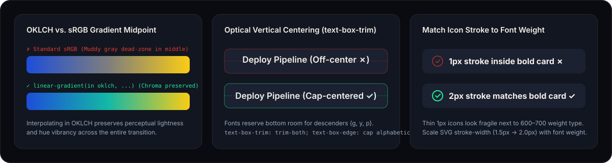
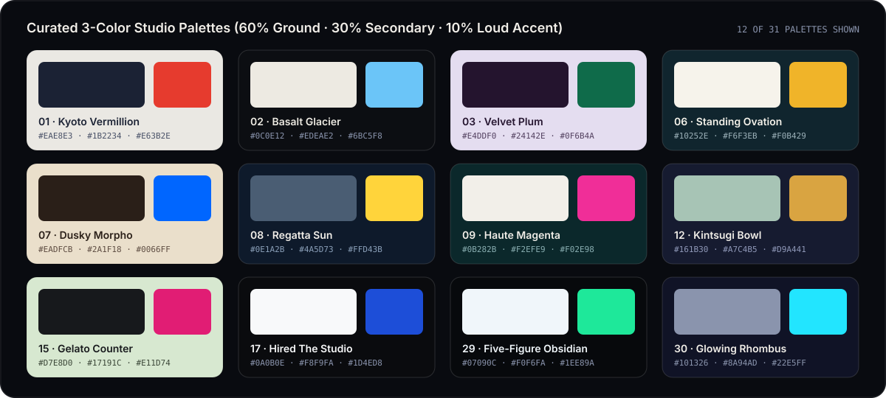

# Color Science, Studio Palettes, Historical Aesthetics & Non-Flat Backgrounds

A technical reference for color perception, curated 3-color palettes, historical art-direction eras, and procedural background textures.



---

## 1. Perceptual Color Rules (`OKLCH`, 60–30–10 & Chroma Discipline)

### Why `OKLCH` Replaces `HSL`
In `hsl()`, a yellow at `50%` lightness (`hsl(60 100% 50%)`) has a relative luminance near `0.93`, while a blue at `50%` lightness (`hsl(240 100% 50%)`) sits near `0.07`. To the human eye, equal HSL lightness numbers look wildly uneven.

`oklch(L C H)` decouples **perceptual lightness** (`L`: `0` to `1`), **chroma** (`C`: `0` to `~0.37`), and **hue** (`H`: `0` to `360`):
- Stepping `L` by `+0.04` produces an identical perceived brightness step across every hue.
- **Fixing muddy gray gradients:** Standard sRGB gradients interpolate straight through the desaturated center of the color cube, turning vibrant blue-to-yellow or purple-to-orange transitions gray in the middle. Interpolate in OKLCH or add an explicit OKLCH midpoint stop:

```css
/* Native OKLCH interpolation — no muddy gray midpoint */
.vivid-gradient {
  background: linear-gradient(135deg in oklch, oklch(0.55 0.22 265), oklch(0.82 0.18 85));
}

/* Explicit OKLCH midpoint stop for legacy fallback control */
.vivid-gradient-explicit {
  background: linear-gradient(
    135deg,
    oklch(0.45 0.18 260) 0%,
    oklch(0.64 0.19 330) 50%,
    oklch(0.78 0.17 55) 100%
  );
}
```

### The 60–30–10 Proportion & "Two Calm, One Loud"
> *Gi to farger som er rolige, så den tredje kan være høylytt. Pick two colors that get along, and one that doesn't.*

- **60% Primary Ground:** A low-chroma surface (`C < 0.03`) that rests the eye (stone grey, black basalt, bone, cream paper, warm umber, deep navy).
- **30% Secondary Structure:** A companion tone that gets along with the ground (deep indigo, slate, celadon, iron brown, soft lilac) used for panels, typography, and structural grouping.
- **10% Loud Accent:** High-chroma signal reserved strictly for what you are selling—the primary CTA, active indicator, or focal product highlight.
  - **Where does the accent go?** On whatever the page is selling. Your headline makes a promise; the accent keeps it.
  - **Source the accent from the subject:** Pull it from the product's physical material—the anodized switch, the paint, the fabric weave, or the specular light.
  - **Temperature counterpoint:** Pair a **warm beige** ground with a **cool accent** (cobalt, morpho blue, glacier cyan, kelly green). Pair a **cool beige/stone** ground with a **warm accent** (vermillion, saffron gold, amber, sun orange).

### Resolving Chroma Competition
When two colors fight for visual attention, lower the chroma (`C`) or shift the lightness (`L`) on the supporting color so the focal color carries the screen:

| Competing Pair | Fix | Visual Result |
| --- | --- | --- |
| **Purple + Cyan** compete at equal saturation | Deepen purple to low-chroma **Night Blue** (`oklch(0.22 0.06 275)`) | The cyan rhombus/signal glows cleanly |
| **Bright Blue + Sun Yellow** shout at the same volume | Deepen blue to **Navy** (`oklch(0.24 0.07 255)`) | The sun yellow pops immediately |
| **Loud Orange background + Warm product** | Fade the background orange to **Soft Peach** (`oklch(0.91 0.045 55)`) | The foreground subject is the first thing seen |

---

## 2. Sixteen Perceptual Color Phenomena

Design decisions must account for how human vision actually decodes light on emissive screens:

| Phenomenon | Mechanism | Interface Implementation |
| --- | --- | --- |
| **Simultaneous contrast** | A neutral patch shifts in perceived lightness and complementary hue depending on its surround (gray looks lighter on black, darker on white). | Never pick swatches on a white canvas if they will live on a dark card. Tune tokens in situ. |
| **Irradiation illusion** | Bright light on a dark background scatters on the retina, making white text on black appear thicker and heavier than black text on white. | On dark themes, use softened bone/ice white (`oklch(0.94 0.008 260)`), loosen tracking by `+0.005em`, or drop font-weight by 50–100 units. |
| **Helmholtz–Kohlrausch effect** | High-chroma colors appear significantly brighter to human eyes than neutral gray of the exact same physical luminance (`Y`). | A saturated accent pill (`C > 0.20`) reads brighter than its luminance number predicts; verify text contrast rigorously. |
| **Abney effect** | Adding white light to a monochromatic color shifts its perceived hue (e.g., saturating/desaturating blue in RGB/HSL shifts toward purple). | Build tint ramps by lowering `C` and raising `L` in `oklch()`, which corrects for hue linearity far better than HSL. |
| **Hunt effect** | Perceived colorfulness (chroma) increases with luminance; colors look washed out at low brightness and hyper-vivid at high brightness. | When adapting a light-mode brand palette to dark mode, reduce accent chroma slightly (`-0.02` to `-0.04`) so accents do not vibrate on dark basalt. |
| **Stevens's power law** | Perceived magnitude $S = k \cdot I^a$ scales as a power function of physical stimulus intensity $I$. | Linear RGB opacity steps look bunched at one end; space surface elevation steps perceptually in `oklch()` lightness. |
| **Chromostereopsis (Chromaopsia)** | Pure high-chroma red and blue refract at different focal depths on the human lens, causing edges to shimmer and strain the eye. | Never place saturated red text or borders directly on a saturated blue background; separate with neutral tone or lower one color's chroma. |
| **Relative luminance** | Physical measure of light emitted ($0.2126 R + 0.7152 G + 0.0722 B$ in linearized sRGB), governing WCAG contrast ratios (`4.5:1` AA body, `3:1` large type/UI, `7:1` AAA). | Test computed hex outputs against actual surface elevation layers, including translucent alpha overlays. |
| **Gamma** | Non-linear transfer curve ($\gamma \approx 2.2$) encoding luminance for display hardware. | Blending colors or anti-aliasing fonts in gamma-encoded sRGB causes dark fringes; use `-webkit-font-smoothing: antialiased` on macOS dark mode. |
| **Tint, Shade & Tone** | **Tint** = base + white (`+L, -C`); **Shade** = base + black (`-L, -C`); **Tone** = base + neutral gray (`-C` at constant `L`). | Build cohesive UI states (`hover`, `active`, `muted`) using tonal chroma adjustments rather than arbitrary hex codes. |
| **Hue, Chroma & Opacity** | **Hue** = angle (`0–360°`); **Chroma** = departure from neutral gray at a given lightness; **Opacity** = alpha transmittance (`0–1`). | Use alpha borders (`oklch(1 0 0 / 0.1)`) so dividers adapt automatically to underlying surface tints. |
| **Analogous colors** | Neighboring hues within a `30°–45°` arc (e.g., slate blue + deep navy, or forest green + celadon). | Use analogous pairs for the 60% ground and 30% secondary structure to create calm cohesion before introducing the 10% contrasting accent. |
| **Additive color** | Emissive RGB light mixing where overlapping channels sum toward white (`mix-blend-mode: screen` / `plus-lighter`). | Use subtle additive specular highlights on dark-mode glass borders; avoid muddy opaque gray shadows. |
| **Sequential scale** | Monotonic lightness progression (`L: 0.95 → 0.25`) optionally paired with a gentle hue rotation. | Use for single-direction magnitude data (heatmaps, volume, density from `0 → max`). |
| **Diverging scale** | Two distinct hues meeting at a low-chroma neutral midpoint (`Loss ← Neutral → Gain`). | Use for signed deltas, correlation matrices, or deviation from a benchmark target. |
| **Increase contrast mode** | OS/browser accessibility signal `@media (prefers-contrast: more)`. | Strip subtle translucency, raise border opacity to `>= 0.5`, and maximize foreground-to-background lightness delta. |

---

## 3. Thirty-One Curated 3-Color Studio Palettes

Every palette below follows the **2 Calm + 1 Loud** rule (`60%` ground, `30%` secondary structure, `10%` accent).



| # | Palette Name | 60% Ground (`--bg`) | 30% Secondary (`--surface` / `--ink`) | 10% Loud Accent (`--accent`) | Character & Art Direction |
| --- | --- | --- | --- | --- | --- |
| 01 | **Kyoto Vermillion** | Stone Grey `#EAE8E3` `oklch(0.93 0.008 85)` | Deep Indigo `#1B2234` `oklch(0.25 0.045 265)` | Vermillion `#E63B2E` `oklch(0.61 0.22 29)` | *Stone grey and deep indigo, very calm. Add a touch of vermillion—now it feels like Kyoto.* |
| 02 | **Basalt Glacier** | Black Basalt `#0C0E12` `oklch(0.16 0.01 255)` | Bone White `#EDEAE2` `oklch(0.93 0.012 85)` | Glacier Blue `#6BC5F8` `oklch(0.79 0.13 230)` | *Black basalt and bone, pretty dark. Bring in glacier blue—now it's worth the trip.* |
| 03 | **Velvet Plum** | Soft Lilac `#E4DDF0` `oklch(0.90 0.03 300)` | Deep Plum `#24142E` `oklch(0.21 0.06 315)` | Velvet Green `#0F6B4A` `oklch(0.47 0.11 160)` | *Lilac and deep plum, soft but muted. Throw in some velvet green—now you want to sink into it.* |
| 04 | **Indie Gig Poster** | Cream Paper `#F5F0E6` `oklch(0.95 0.016 82)` | Raisin / Resene `#211C22` `oklch(0.23 0.02 325)` | Fluorescent Pink `#FF2A85` `oklch(0.65 0.26 350)` | *Cream paper and raisin, very indie. Drop in fluorescent pink—now it's a gig poster.* |
| 05 | **Artisan Kiln** | Rock Clay `#C8B7A6` `oklch(0.78 0.03 65)` | Iron Brown `#2C221E` `oklch(0.26 0.025 45)` | Turquoise `#19B5B0` `oklch(0.71 0.13 190)` | *Rock clay and iron brown, earthy but dull. Add a touch of turquoise—now you want to make one.* |
| 06 | **Standing Ovation** | Petrol Blue `#10252E` `oklch(0.26 0.04 225)` | Warm Ivory `#F6F3EB` `oklch(0.96 0.012 88)` | Saffron Gold `#F0B429` `oklch(0.80 0.16 82)` | *Petrol blue and ivory, graceful but quiet. Add a little saffron gold—now it deserves a standing ovation.* |
| 07 | **Dusky Morpho** | Old Paper `#EADFCB` `oklch(0.90 0.03 80)` | Deep Umber `#2A1F18` `oklch(0.24 0.03 55)` | Morpho Blue `#0066FF` `oklch(0.56 0.23 260)` | *Old paper and deep umber, kind of dusky. Add a little morpho blue—now it looks alive.* |
| 08 | **Regatta Sun** | Slate Blue `#4A5D73` `oklch(0.47 0.045 245)` | Deep Navy `#0E1A2B` `oklch(0.22 0.05 255)` | Sun Yellow `#FFD43B` `oklch(0.88 0.18 92)` | *Slate blue and navy, looks fine. Add some sun yellow—now you want to go sailing.* |
| 09 | **Haute Magenta** | Deep Teal `#0B282B` `oklch(0.26 0.045 205)` | Bone White `#F2EFE9` `oklch(0.95 0.01 85)` | Magenta / Fuchsia `#F02E98` `oklch(0.63 0.26 342)` | *Deep teal and bone, elegant but still. Add a pop of magenta/fuchsia—now the dress steals the show.* |
| 10 | **Opening Night** | Forest Green `#132A1F` `oklch(0.26 0.05 155)` | Bone `#F0ECE1` `oklch(0.94 0.015 85)` | Stage Vermillion `#EE3E2B` `oklch(0.62 0.22 30)` | *Forest green and bone, feels like a dress rehearsal. Add vermillion—now it's opening night.* |
| 11 | **Aegean Coast** | Warm Sand `#EBDDC8` `oklch(0.90 0.03 78)` | Terracotta `#B5543A` `oklch(0.55 0.13 38)` | Cobalt Blue `#1446C8` `oklch(0.46 0.20 264)` | *Sand and terracotta—where is the sea? Bring in cobalt, and there it is.* |
| 12 | **Kintsugi Bowl** | Deep Indigo `#161B30` `oklch(0.23 0.05 270)` | Celadon `#A7C4B5` `oklch(0.79 0.04 160)` | Kintsugi Gold `#D9A441` `oklch(0.74 0.14 82)` | *Indigo and celadon, a broken bowl. One stroke of gold—now the cracks are the best part.* |
| 13 | **Eyewear Editorial** | Washed Stone `#EFECE6` `oklch(0.94 0.01 80)` | Deep Wine `#2B121A` `oklch(0.21 0.05 10)` | Kelly Green `#16A34A` `oklch(0.63 0.18 148)` | *Wash and deep wine chic. Go Kelly green—now you see the glasses first.* |
| 14 | **Lived-In Window** | Midnight Navy `#0D1624` `oklch(0.20 0.04 255)` | Warm Cream `#F5EFE2` `oklch(0.95 0.02 84)` | Window Amber `#F59E0B` `oklch(0.77 0.17 72)` | *Navy and cream, every window's dark. Add a little amber—now it looks lived in.* |
| 15 | **Gelato Counter** | Pistachio `#D7E8D0` `oklch(0.90 0.04 140)` | Espresso Ink `#17191C` `oklch(0.21 0.01 250)` | Raspberry Pink `#E11D74` `oklch(0.58 0.23 355)` | *Pistachio and ink, a gelato shop with no gelato. Drop in raspberry pink—now you want one.* |
| 16 | **Monochrome Pop** | Pitch Black `#080808` `oklch(0.14 0 0)` | Crisp White `#FFFFFF` `oklch(1 0 0)` | Hot Pink `#FF1F7A` `oklch(0.63 0.26 352)` | *Black and white, could be any brand. Add hot pink—now it has its own look.* |
| 17 | **Hired The Studio** | Carbon Black `#0A0B0E` `oklch(0.15 0.005 260)` | Studio White `#F8F9FA` `oklch(0.98 0.002 250)` | Studio Cobalt `#1D4ED8` `oklch(0.49 0.21 264)` | *Can't go wrong with black. One touch of cobalt blue—now you've hired the studio.* |
| 18 | **Layered Violet** | Deep Violet `#1A102E` `oklch(0.21 0.07 295)` | Pure White `#FAFAFC` `oklch(0.99 0.003 290)` | Electric Lime `#B8FF1A` `oklch(0.92 0.23 125)` | *Deep violet and white, pretty plain. Throw in electric lime—now you notice the layers.* |
| 19 | **Specular Chrome** | Warm Taupe `#3A332E` `oklch(0.33 0.02 60)` | Heliotrope `#B993F4` `oklch(0.72 0.14 300)` | Vibrant Chrome `#EAEEF5` `oklch(0.95 0.01 250)` | *Taupe and heliotrope look splendid. Throw in vibrant specular chrome—now you can't look away.* |
| 20 | **Solar Cobalt** | Studio White `#F6F7F9` `oklch(0.97 0.004 250)` | Cobalt `#1939B7` `oklch(0.42 0.18 264)` | Sun Orange `#FF5C1A` `oklch(0.67 0.22 38)` | *Cobalt and studio white, kind of generic. Add a little sun orange—now the page makes sense.* |
| 21 | **Acid Signal** | Charcoal `#141416` `oklch(0.19 0.005 270)` | Soft Grey-White `#D8D8DC` `oklch(0.88 0.005 270)` | Acid Lime `#CCFF00` `oklch(0.93 0.24 122)` | *Black and white when contrast feels flat—a shot of acid lime and you can't miss it.* |
| 22 | **Citrus Gorge** | Warm Cream `#FAF3E6` `oklch(0.96 0.02 82)` | Gorge Orange `#D9531E` `oklch(0.60 0.19 42)` | Refreshing Lime `#7CD926` `oklch(0.81 0.21 132)` | *Gorge orange and cream, a lot of warmth. Add a little lime—now it looks refreshing.* |
| 23 | **Planetarium Show** | Warm Umber `#231914` `oklch(0.22 0.025 50)` | Soft Cream `#F3ECE1` `oklch(0.94 0.018 80)` | Galaxy Cyan `#18E0FF` `oklch(0.84 0.15 210)` | *Warm umber and cream, gorgeous. One touch of galaxy cyan—now you can see the show.* |
| 24 | **Portrait Depth** | Jet Black `#090B10` `oklch(0.15 0.01 260)` | Electric Cyan `#00D2FF` `oklch(0.80 0.15 218)` | Vivid Magenta `#FF1E8E` `oklch(0.64 0.26 350)` | *Black and cyan, a bit flat. Add a little magenta—now lighting and skin tones have depth.* |
| 25 | **Desert Lapidary** | Raw Ochre `#C99238` `oklch(0.70 0.13 75)` | Deep Umber `#251A12` `oklch(0.22 0.03 55)` | Oasis Turquoise `#14C8B8` `oklch(0.76 0.13 185)` | *Ochre and deep umber, solid. Add a little turquoise—now it pulls your attention.* |
| 26 | **Roastery Nocturne** | Indigo-Black `#0F111C` `oklch(0.18 0.025 270)` | Bone `#EAE5DA` `oklch(0.92 0.015 85)` | Roasted Amber `#E89225` `oklch(0.73 0.16 68)` | *Indigo, black, and bone looks empty. Add a touch of amber—now you can almost smell it.* |
| 27 | **Spotlight Stage** | Espresso Brown `#1E1510` `oklch(0.20 0.025 52)` | Pale Gold `#DFC99B` `oklch(0.84 0.06 85)` | Glowing Gold `#FFCC33` `oklch(0.86 0.17 88)` | *Brown and pale gold looks good. Add a little glowing gold—now you're on stage.* |
| 28 | **Night Festival** | Pitch Black `#0B0B0D` `oklch(0.15 0.005 280)` | Festival Lime `#B5FF14` `oklch(0.92 0.23 125)` | Hot Pink `#FF1D8E` `oklch(0.64 0.26 350)` | *Lime and black, already loud. Throw in hot pink—now it feels like a festival.* |
| 29 | **Five-Figure Obsidian** | Obsidian `#07090C` `oklch(0.14 0.008 250)` | Ice White `#F0F6FA` `oklch(0.97 0.008 230)` | Aurora Green `#1EE89A` `oklch(0.83 0.18 160)` | *Black and ice white, classic. Add a touch of aurora green—now it looks worth five figures.* |
| 30 | **Glowing Rhombus** | Night Blue `#101326` `oklch(0.19 0.05 275)` | Deep Slate `#8A94AD` `oklch(0.67 0.03 265)` | Rhombus Cyan `#22E5FF` `oklch(0.85 0.15 208)` | *Purple and cyan compete. Turn the purple night blue—now the rhombus glows.* |
| 31 | **Sorbet Parlour** | Soft Peach `#FADAC8` `oklch(0.90 0.045 48)` | Vanilla Cream `#FFFDF9` `oklch(0.99 0.008 85)` | Sorbet Berry `#D42257` `oklch(0.54 0.21 12)` | *Loud orange overwhelms the shot. Fade it to peach—now the ice cream is the first thing you see.* |

---

## 4. Twenty Historical & Editorial Art-Direction Eras

When a brief calls for a distinct cultural or industrial vernacular instead of generic tech minimalism, ground the token system in one of these twenty historical aesthetics:

| # | Aesthetic Era | Core Visual DNA | Palette Tokens | Typography & Grid Structure |
| --- | --- | --- | --- | --- |
| 01 | **Y2K Sony Ads** | Anodized metallic silver, Cyber-shot/VAIO industrial optimism, crisp technical callouts, glowing LED indicators. | Silver `#D8DEE9`, Titanium `#3B4252`, VAIO Lavender `#7B68EE`, Cyber Lime `#00FF9D`. | Tightly tracked neo-grotesk (`Aktiv Grotesk` / `Switzer`), micro monospace spec tables (`9px`), hairline callout leaders. |
| 02 | **Mexico '68 Olympic Op-Art** | Lance Wyman's radiating concentric parallel lines forming letterforms and kinetic geometry. | Olympic Magenta `#E6007E`, Solar Orange `#FF5900`, Lime `#8CE000`, Deep Black `#0D0D0D`. | Custom multi-line inline display titles; bold horizontal/radial stripe rhythms that guide eye movement. |
| 03 | **Patrick Nagel** | High-contrast flat vector pop illustration, stark porcelain highlights, razor-sharp shadow planes, 1980s gallery cool. | Porcelain White `#FAF9F6`, Sumi Black `#0C0C0E`, Nagel Coral `#F2545B`, Pool Teal `#38B2AC`. | Tall, high-fashion condensed display or razor-thin geometric sans; extreme negative space and asymmetric crops. |
| 04 | **NASA 1975 Graphic Manual** | Richard Danne & Bruce Blackburn's Federal Design manual: clinical Swiss specifications, binder grid lines, technical authority. | Archival Paper `#F4F3EF`, Carbon Ink `#141413`, NASA Worm Red `#FC3D21`, Insignia Blue `#0B3D91`. | Flush-left `Helvetica` / `ABC Favorit` / `Switzer`, explicit specification columns, 12-column modular grid with visible margin discipline. |
| 05 | **Googie Signs** | Mid-century Space Age roadside architecture: canted roofs, boomerangs, atomic starbursts, neon script + geometric block letters. | Dusk Turquoise `#1B998B`, Atomic Coral `#FF6B35`, Starlight Custard `#FFF3B0`, Night Asphalt `#1E1E24`. | Playful interlocking letter tiles paired with dynamic slanted display accents and tapered geometric badge shapes. |
| 06 | **Psychedelic Pop Ads** | Milton Glaser / Push Pin Studios: flat sinuous contours, high-chroma unexpected color juxtapositions on warm book stock. | Book Cream `#F6EEDB`, India Ink `#1A1615`, Acid Violet `#8A2BE2`, Marigold `#FF9F1C`, Emerald `#00A878`. | Expressive editorial display faces paired with disciplined book-column body copy; rich flat illustration fills. |
| 07 | **Dieter Rams Braun** | Functionalist industrial honesty (*Weniger, aber besser*): matte injection-molded shells, recessed dials, one orange toggle switch. | Braun Shell `#EAE9E4`, anodized Aluminum `#D2D1CD`, Dial Charcoal `#222325`, Switch Orange `#EA4C1D`. | Unadorned `Akzidenz` / `Aktiv Grotesk` / `ABC Diatype`, strict orthogonal alignment, circular dial motifs, zero ornament. |
| 08 | **VHS Tape Covers** | Blank media sleeve geometry (Scotch / Maxell / TDK): diagonal multi-band color ribbons across matte black cardboard or silver foil. | Sleeve Black `#0F0E12`, Kodak Gold `#F4B942`, Sunset Orange `#E85D25`, Berry `#B81D64`, Deep Purple `#4A1942`. | Heavy geometric sans (`ABC Monument Grotesk` / `Degular`), bold weight contrast, subtle analog film grain. |
| 09 | **Dark Deco** | *Metropolis* & *Batman: TAS* architectural chiaroscuro: towering verticality, dramatic uplighting, obsidian, oxblood, and aged brass. | Obsidian `#08070A`, Oxblood `#3D0C11`, Aged Brass `#C89D54`, Fog Grey `#A39E93`. | Tall geometric condensed capitals, art-deco stepped corner chamfers (`clip-path`), dramatic vertical light columns. |
| 10 | **Jet Age Airline Posters** | David Klein / TWA / Pan Am 1950s–60s lithographs: gouache vector vistas, mid-century optimism, sunlit horizon silhouettes. | Stratosphere Blue `#133863`, Sunlit Gold `#F7B538`, Coral Horizon `#E85D4A`, Cloud Cream `#F7F4EA`. | Clean, wide-tracked uppercase destination headers over full-bleed vector scenery; minimal bottom banner bar. |
| 11 | **Koichi Sato Gradients** | Japanese poster minimalism: luminous, airbrushed twilight transitions where color fields glow in complete stillness. | Twilight Indigo `#111633`, Horizon Violet `#4F3B78`, Biwa Peach `#F4A27E`, Mist White `#F5F6FA`. | Whisper-quiet small typography anchored near margins, letting the atmospheric OKLCH gradient carry the entire viewport. |
| 12 | **Y2K Clear Plastic** | Translucent polycarbonate industrial design (iMac G3 Bondi Blue, Atomic Purple Game Boy Color): visible internal circuitry under frosted resin. | Atomic Purple `rgba(110, 68, 255, 0.24)`, Bondi Cyan `#0095B6`, PCB Gold `#E5B84B`, Frosted Shell `rgba(255,255,255,0.65)`. | `backdrop-filter: blur(14px) saturate(160%)`, inner specular top highlights (`inset 0 1px 1px rgba(255,255,255,0.7)`), underlying SVG circuit trace layer. |
| 13 | **French Open (Roland-Garros) Posters** | Terre battue crushed brick clay, crisp chalk baseline geometry, deep Parisian court green, contemporary gallery art direction. | Clay Terracotta `#C85A32`, Court Forest `#174030`, Chalk Line `#F9F8F3`, Shadow Umber `#231915`. | Crisp white geometric line rules cutting across rich terracotta fields; editorial serif/grotesk contrast. |
| 14 | **Vintage Matchbooks** | Two-color relief block printing on coarse chipboard: slight ink misregistration, worn paper edges, bold woodblock badges. | Chipboard `#E6DAC3`, Faded Crimson `#B8332A`, Stamp Navy `#1D2D44`. | High-ink-trap display lettering, thick block borders, halftone stipple shading, `mix-blend-mode: multiply` ink overlap. |
| 15 | **Mission Control Rooms** | Houston / Apollo / NORAD telemetry consoles: recessed dark metal bays, phosphor amber & green vector displays, physical rocker switches. | Console Slate `#11161B`, Bezel Iron `#1E262E`, Phosphor Green `#33FF77`, Telemetry Amber `#FFB000`. | Strict tabular monospace (`IBM Plex Mono` / `Commit Mono`), status indicator matrices, live telemetry sparklines, recessed inset borders. |
| 16 | **One-Color Perfume Ads** | Monochromatic high-fashion editorial lighting: the entire scene bathed in a single deep jewel hue where glass refraction creates the hierarchy. | Deep Emerald `#072B22` (or Ruby `#380814` / Cobalt `#091845`), Specular Highlight `#DDFEF4`, Rim Accent `#1EE89A`. | Ultra-refined display typography with generous letter-spacing or tight editorial serif; focal liquid/glass bottle lighting. |
| 17 | **Italian Futurism Ads** | Fortunato Depero / Campari kinetic posters: diagonal typography in motion, aggressive geometric perspective, industrial velocity. | Campari Red `#D92B2B`, Coal Black `#111111`, Poster Ivory `#F4EFE0`, Steel Blue `#2C5E8A`. | Rotated typographic axes (`-12deg` / `+15deg`), contrasting scale jumps, hard-edged constructivist vector silhouettes. |
| 18 | **Swiss Annual Report Covers** | Josef Müller-Brockmann / Karl Gerstner corporate modernism: mathematical grid proportions, objective data abstraction, flush-left discipline. | Archival White `#F7F7F5`, Press Black `#101010`, Signal Red `#E0241A` or Cobalt `#0047BB`. | Single neo-grotesk family (`ABC Diatype` / `Switzer` / `TWK Lausanne`), strict baseline grid, zero centered text, geometric data motif. |
| 19 | **1950s Fortune Magazine Covers** | Walter Allner / Leo Lionni mid-century executive modernism: fine-art printmaking fused with industrial economics and engineering diagrams. | Linen Paper `#F2ECE1`, Litho Black `#1A1918`, Ochre Gold `#D4952A`, Industrial Slate `#4A6274`. | Sophisticated editorial typography paired with symbolic architectural or industrial diagrams drawn in code/SVG. |
| 20 | **Moody Corporate Futurism** | Nocturnal institutional precision (Linear / Palantir / Stripe Dark): brushed titanium, directional rim lighting, quiet authority. | Deep Basalt `#090A0F`, Titanium Surface `#131620`, Specular Edge `rgba(255,255,255,0.11)`, Signal Cyan `#38BDF8`. | Tightly tracked grotesk headings (`-0.03em`), high-contrast bone ink, subtle top-edge light catch, real interactive product fragments. |

---

## 5. Twenty-Two Non-Flat Background & Texture Recipes

Flat solid hex fills often make a web page feel empty or unfinished. Use one of these twenty-two surface treatments to add physical depth without cluttering the foreground:

| # | Texture / Background | Best Used For | Implementation Recipe |
| --- | --- | --- | --- |
| 01 | **Fault Texture** | Architecture, earth sciences, rugged hardware | Layered SVG polygon strata with subtle `1px` elevation offset and directional shadow seam. |
| 02 | **Fluid Glass** | Floating navbars, interactive cards over video/3D | `backdrop-filter: blur(20px) saturate(180%)` + inline SVG `<feTurbulence>` + `<feDisplacementMap scale="14">` for optical edge refraction (or `Glisse`). |
| 03 | **Thermal Gradients** | AI compute, sensors, music festivals, creative labs | Multi-stop `oklch()` map following infrared blackbody radiation: deep indigo → magenta → vermillion → solar yellow → white. |
| 04 | **Water Ripples** | Hospitality, wellness, luxury beauty, audio | WebGL heightmap ping-pong buffer (`WebGL-Fluid-Simulation`) or SVG animated `<feTurbulence baseFrequency="0.015 0.03">` displacement. |
| 05 | **Speckled Graphite** | Dark-mode developer tools, industrial hardware | High-frequency SVG `<feTurbulence type="fractalNoise" baseFrequency="0.85" numOctaves="3">` overlaid at `opacity: 0.045; mix-blend-mode: overlay`. |
| 06 | **Single-Hue Landscapes** | Atmospheric story pages, outdoor/travel brands | 4–6 overlapping SVG mountain/horizon silhouettes stepping from `oklch(0.18 0.04 H)` in the foreground to `oklch(0.45 0.03 H)` in the distance. |
| 07 | **Blueprint Grids** | Engineering, CAD, architecture, security systems | Dual CSS `linear-gradient` grid (`80px` major lines at `0.10` alpha + `16px` minor lines at `0.04` alpha) faded at the edges with a radial `mask-image`. |
| 08 | **Halftone** | Editorial zines, brutalist portfolios, retro-tech | `radial-gradient(circle, currentColor 1.5px, transparent 1.5px)` with variable dot sizing or GLSL screen-space halftone dither (`Shader Lab` / `Paper Shaders`). |
| 09 | **Grainy Gradients** | Hero backdrops, atmospheric section transitions | Smooth `in oklch` radial/linear mesh gradient topped with a locked `pointer-events: none` fractal noise film grain (`ShaderGradient`). |
| 10 | **Grass / Organic Fiber** | Sustainability, botanicals, agritech, craft paper | Directional anisotropic noise (`baseFrequency="0.04 0.45"`) simulating natural plant or woven fiber directionality. |
| 11 | **Dithered Images** | Archival journals, low-bandwidth art pages, retro engineering | Ordered 4×4 Bayer matrix or Atkinson dithering shader converting photography into a 2-color palette (ground + ink). |
| 12 | **Paper Texture** | Publishing, law, research reports, indie studios | Warm off-white `#F5F1E8` combined with low-frequency cloud mottling (`baseFrequency="0.02"`) + fine grain (`baseFrequency="0.7"`) at `0.04` opacity. |
| 13 | **Contour Lines** | Geospatial, defense, outdoor gear, data platforms | Concentric SVG topographic isolines (`stroke-width: 1px; stroke: oklch(1 0 0 / 0.08); fill: none`) generated via marching squares. |
| 14 | **Cloud Sky** | Aviation, climate tech, calm consumer apps | Real-time volumetric clouds (`@takram/three-geospatial` / `Vanta.CLOUDS`) or multi-layered parallax alpha cloud sprites. |
| 15 | **Pixel Mosaics** | Cryptography, media compression, interactive galleries | Canvas/WebGL UV quantization (`floor(uv * grid) / grid`) that resolves from coarse blocks to full resolution on load or hover. |
| 16 | **Lens Distortion** | Photography portfolios, optics, cinema | WebGL barrel distortion + subtle RGB channel separation (`0.002` UV offset) restricted to the outer 15% of the viewport frame. |
| 17 | **Stippled Gradients** | Scientific illustration, book arts, fintech | Stochastic point-density distribution where dot spacing—not opacity—encodes the transition from shadow to light. |
| 18 | **Square Dot Grids** | Canvas editors, node graphs, workspace tools | `background-image: radial-gradient(oklch(0.5 0 0 / 0.22) 1px, transparent 1px); background-size: 20px 20px;` masked around focal text. |
| 19 | **Blurred Photos** | Music players, event pages, contextual headers | Real subject photograph scaled to `115%` with `filter: blur(48px) saturate(140%)` and a directional scrim matching the page ground. |
| 20 | **Iridescent Shapes** | Collectible cards, hardware launches, creative tools | Thin-film interference simulation using `conic-gradient` in `oklch` + `mix-blend-mode: color-dodge` (`pokemon-cards-css` holographic foil). |
| 21 | **Impressionist Paintings** | Cultural institutions, luxury heritage, essays | High-resolution public-domain museum artwork (fetched and credited via `scripts/assets.mjs`) cropped dramatically to a brushwork detail. |
| 22 | **ASCII & Pixels** | CLI tools, compilers, cybersecurity labs | Live interactive character-luminance canvas mapping (`" .:-=+*#%@"`) driven by real 3D geometry or cursor distance—never static decorative slop on unrelated brands. |

### Copy-Paste CSS Recipes for Key Textures

```css
/* 1. Blueprint Dual-Scale Grid with Radial Edge Fade */
.bg-blueprint-grid {
  --grid-major: oklch(0.65 0.08 245 / 0.12);
  --grid-minor: oklch(0.65 0.08 245 / 0.04);
  background-color: oklch(0.16 0.02 250);
  background-image:
    linear-gradient(to right, var(--grid-major) 1px, transparent 1px),
    linear-gradient(to bottom, var(--grid-major) 1px, transparent 1px),
    linear-gradient(to right, var(--grid-minor) 1px, transparent 1px),
    linear-gradient(to bottom, var(--grid-minor) 1px, transparent 1px);
  background-size: 80px 80px, 80px 80px, 16px 16px, 16px 16px;
  mask-image: radial-gradient(ellipse 80% 70% at 50% 40%, #000 55%, transparent 100%);
}

/* 2. Thermal Infrared OKLCH Gradient */
.bg-thermal-oklch {
  background: radial-gradient(
    120% 90% at 75% 25% in oklch,
    oklch(0.92 0.16 95) 0%,
    oklch(0.68 0.22 35) 28%,
    oklch(0.52 0.24 345) 56%,
    oklch(0.24 0.11 285) 82%,
    oklch(0.14 0.03 265) 100%
  );
}

/* 3. Square Dot Grid (Workspace / Canvas) */
.bg-dot-matrix {
  background-image: radial-gradient(oklch(0.55 0.01 260 / 0.24) 1px, transparent 1px);
  background-size: 20px 20px;
  background-position: -1px -1px;
}

/* 4. Speckled Graphite / Archival Grain Overlay (pair with inline SVG #grain-filter) */
.grain-overlay {
  position: fixed;
  inset: 0;
  pointer-events: none;
  z-index: 50;
  opacity: 0.045;
  mix-blend-mode: overlay;
  background-image: url("data:image/svg+xml,%3Csvg viewBox='0 0 200 200' xmlns='http://www.w3.org/2000/svg'%3E%3Cfilter id='n'%3E%3CfeTurbulence type='fractalNoise' baseFrequency='0.8' numOctaves='3' stitchTiles='stitch'/%3E%3C/filter%3E%3Crect width='100%25' height='100%25' filter='url(%23n)'/%3E%3C/svg%3E");
}
```
