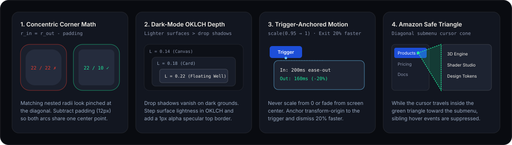

# Optical Typography, Surface Geometry & Anti-Slop Refactoring

Concrete rules for typeface selection, optical CSS adjustments, concentric geometry, and removing generated-UI tells.



---

## 1. Typeface Selection Matrix

Models default to the same six fonts across almost every generated site. Replace them with intentional studio grotesks and disciplined technical monospaces.

### Approved Sans-Serif Faces
- **Open / Web-Ready CDN:**
  - `Switzer` (Fontshare: `https://api.fontshare.com/v2/css?f[]=switzer@300,400,500,600,700&display=swap`)
  - `Familjen Grotesk` (Google Fonts)
  - `Apfel Grotesk` (Collletttivo open-source foundry)
  - `Arial` / `Helvetica Neue` (System neo-grotesk fallback)
- **Commercial / Studio Foundries (use when licensed or self-hosted in project):**
  - `ABC Diatype`, `ABC Favorit`, `ABC Monument Grotesk`, `ABC Oracle` (Dinamo)
  - `TWK Lausanne` (Weltkern)
  - `PP Mori` (Pangram Pangram)
  - `Aeonik` (CoType Foundry)
  - `Degular` (OH no Type Co.)
  - `GT Walsheim` (Grilli Type)
  - `Circular` (Lineto)
  - `Aktiv Grotesk` (Dalton Maag)
  - `Studio Feixen Sans` (Studio Feixen)
  - `Strichpunkt Sans` (Strichpunkt)

### Approved Monospace Faces (Numbers, Code & Telemetry Only)
Use monospace **only** where character alignment or code syntax demands it—never for decorative eyebrows on every section.
- **Open / Web-Ready:** `IBM Plex Mono`, `Commit Mono`, `Departure Mono`
- **Commercial / Studio:** `ABC Diatype Mono`, `Söhne Mono` (Klim), `GT America Mono` (Grilli Type)

### Banned Default AI-Slop Fonts
Do **not** reach for these unless an existing brand specification mandates them:
- ❌ `Geist` / `Geist Mono`
- ❌ `Space Grotesk`
- ❌ `Bricolage Grotesque`
- ❌ `Instrument Sans`
- ❌ `Instrument Serif`
- ❌ `JetBrains Mono`

---

## 2. Ten Optical Typography Fixes (Plus Tracking, Leading & Alignment)

### 1. Reserve Bold Width to Prevent Layout Shift
When a navigation link or tab switches from `font-weight: 400` to `600`/`700` on hover or active state, the glyphs widen and push adjacent items sideways. Reserve the bold width using an invisible pseudo-element reading `data-text`:

```css
.nav-tab {
  display: inline-flex;
  flex-direction: column;
  align-items: center;
  justify-content: space-between;
}
.nav-tab::after {
  content: attr(data-text);
  font-weight: 700;
  height: 0;
  visibility: hidden;
  overflow: hidden;
  user-select: none;
  pointer-events: none;
}
```

### 2. Trim Descender Box Space (`text-box-trim`)
Fonts reserve vertical space below the baseline for descenders (`g`, `j`, `p`, `q`, `y`), which makes single-line text inside buttons, pills, and cards sit slightly too high. Trim the em-box to the cap height and alphabetic baseline:

```css
.btn, .badge, .card-title, h1, h2 {
  text-box-trim: trim-both;
  text-box-edge: cap alphabetic;
}
```

### 3. Protect Descenders from Underlines (`text-underline-offset`)
Default browser underlines slice right through every `g`, `p`, and `y`. Push the underline clear of the baseline and enable ink skipping:

```css
a:not([class]) {
  text-decoration: underline;
  text-decoration-thickness: 1px;
  text-underline-offset: 0.18em;
  text-decoration-skip-ink: auto;
}
```

### 4. Zero Out `<sub>` and `<sup>` Line-Height
Inline `<sub>` and `<sup>` elements inherit the parent line-height by default, prying open the gap between just those two rows in a paragraph. Lock their line-height to `0`:

```css
sub, sup {
  font-size: 0.75em;
  line-height: 0;
  position: relative;
  vertical-align: baseline;
}
sup { top: -0.5em; }
sub { bottom: -0.25em; }
```

### 5. Fluid Headline Sizing with `clamp()`
Avoid jarring font-size jumps at discrete media-query breakpoints. Interpolate smoothly across viewport widths:

```css
.display-h1 {
  font-size: clamp(2.25rem, 4.5vw + 1rem, 5.25rem);
  line-height: 0.96;
  letter-spacing: -0.03em;
  text-wrap: balance;
}
```

### 6. Tame Loud All-Caps Acronyms with `all-small-caps`
Three- and four-letter acronyms (`API`, `NATO`, `GDPR`, `HTML`) in full capitals tower over surrounding lowercase body copy. Set them in small caps so they match the x-height rhythm:

```css
abbr, .acronym {
  font-variant-caps: all-small-caps;
  letter-spacing: 0.04em;
}
```

### 7. True Typographic Quotes & Ellipses
Straight typewriter quotes (`" "`, `' '`) and three periods (`...`) read as raw unformatted strings.
- **English:** `“ ”` (`&ldquo;` / `&rdquo;`) and `‘ ’` (`&lsquo;` / `&rsquo;`)
- **Norwegian:** `« »` (`&laquo;` / `&raquo;`) and `‘ ’`
- **Ellipsis:** `…` (`&hellip;`)
- **Non-breaking space between value and unit:** `24&nbsp;ms`, `100&nbsp;MB`, `⌘&nbsp;K`

### 8. Middle-Truncate Filenames so Extensions Remain Visible
Standard `text-overflow: ellipsis` chops off the end of a filename (`quarterly-financial-report-2026-v3.pdf` → `quarterly-financial-rep…`), hiding whether the file is a `.pdf`, `.csv`, or `.zip`. Truncate in the middle:

```ts
export function truncateMiddle(filename: string, maxLength = 28): string {
  if (filename.length <= maxLength) return filename;
  const dotIndex = filename.lastIndexOf(".");
  const ext = dotIndex > 0 ? filename.slice(dotIndex) : "";
  const base = dotIndex > 0 ? filename.slice(0, dotIndex) : filename;
  const keep = Math.max(4, maxLength - ext.length - 1);
  const head = Math.ceil(keep * 0.6);
  const tail = Math.floor(keep * 0.4);
  return `${base.slice(0, head)}…${base.slice(base.length - tail)}${ext}`;
}
```

Or in pure CSS with a split flex container (`.filename-base { overflow: hidden; text-overflow: ellipsis; white-space: nowrap; }` + `.filename-ext { flex-shrink: 0; }`).

### 9. Hyphenate Narrow Columns
Narrow text columns (`< 38ch`) develop ugly rivers of whitespace between long words—especially in compound-word languages like Norwegian and German. Enable automatic hyphenation (requires a valid `lang` attribute on `<html lang="nb">` or `<html lang="en">`):

```css
.narrow-prose {
  hyphens: auto;
  -webkit-hyphens: auto;
  overflow-wrap: break-word;
  text-wrap: pretty;
}
```

### 10. Cap Variable Card Titles with `line-clamp`
When user-generated or CMS titles vary from 3 words to 18 words, adjacent cards in a grid break horizontal alignment. Cap title rows cleanly:

```css
.card-heading {
  display: -webkit-box;
  -webkit-box-orient: vertical;
  -webkit-line-clamp: 2;
  overflow: hidden;
  text-wrap: balance;
}
```

### Additional Typographic Precision Rules
- **Tabular numbers (`tabular-nums`):** Apply `font-variant-numeric: tabular-nums` to all tables, prices, counters, timers, and live metrics so digits occupy identical horizontal widths and never jitter during updates.
- **Size-specific tracking & leading:** Large display type (`> 48px`) requires tight leading (`0.90–1.05`) and negative tracking (`-0.02em` to `-0.045em`). Body copy (`15–18px`) requires neutral tracking (`0` to `-0.01em`) and open leading (`1.5–1.65`). Micro-labels (`11–12px`) need positive tracking (`+0.04em` to `+0.08em`).
- **Optical center vs. geometric bounding box:** A triangle play icon centered mathematically inside a circle looks shifted to the left because its mass sits on the vertical base. Nudge triangular icons `+1.5px` toward their point. Align icons to adjacent cap-height centers by eye, not raw bounding-box top.
- **Prevent widows:** Apply `text-wrap: balance` on headings (`<= 6` lines) and `text-wrap: pretty` on body paragraphs so the final line never strands a single word.

---

## 3. Geometry, Borders, Surfaces & Blending

### 1. Concentric Corner Radius Math (`r_inner = r_outer - padding`)
Nested rounded corners with identical border radii look pinched and uneven at the diagonal corners because the circles do not share a center point. Always subtract the container padding from the outer radius:

```css
.card-outer {
  --outer-radius: 24px;
  --card-padding: 8px;
  border-radius: var(--outer-radius);
  padding: var(--card-padding);
}

.card-inner {
  /* Concentric curve: 24px - 8px = 16px */
  border-radius: max(4px, calc(var(--outer-radius) - var(--card-padding)));
}
```

### 2. Continuous Corners (Apple Squircle Approximation)
Standard CSS circular arcs (`border-radius`) transition abruptly from a straight line (`curvature = 0`) to a constant circle (`curvature = 1/r`), creating a visible Mach-band crease where the curve starts. When showcasing hardware cards, app icons, or hero media frames, use smooth curvature continuity (`clip-path` superellipse or SVG path):

```css
/* Progressive enhancement for continuous corner smoothing */
.squircle-card {
  border-radius: 24px;
  corner-shape: squircle; /* CSS Borders 4 where supported */
}
```

### 3. Alpha Borders Instead of Solid Hex Borders
A solid hex border (`#2A2E39` or `#E2E8F0`) clashes as soon as it crosses a tinted background, hover highlight, or subtle gradient. Use low-opacity alpha borders so the stroke blends with whatever surface sits behind it:

```css
:root {
  --border-subtle: oklch(0 0 0 / 0.08);
  --border-strong: oklch(0 0 0 / 0.15);
}
[data-theme="dark"] {
  --border-subtle: oklch(1 0 0 / 0.09);
  --border-strong: oklch(1 0 0 / 0.16);
  --border-specular-top: oklch(1 0 0 / 0.22); /* top-edge light catch */
}
```

### 4. Dark-Mode Depth via Surface Lightness, Not Drop Shadows
In dark mode, black drop shadows fall onto a near-black canvas and disappear—or worse, people turn them into muddy gray/colored glows. Build elevation in dark mode by stepping `oklch()` surface lightness upward as layers move closer to the user:

```css
[data-theme="dark"] {
  --surface-canvas:   oklch(0.14 0.008 260); /* Base page ground */
  --surface-raised-1: oklch(0.18 0.010 260); /* Card / Sidebar */
  --surface-raised-2: oklch(0.22 0.012 260); /* Nested well / Hover state */
  --surface-floating: oklch(0.26 0.014 260); /* Popover / Command menu */
}
```

### 5. Match Icon Stroke Width to Font Weight
Thin `1px` wireframe icons look fragile and disconnected inside cards set in medium (`500`) or semibold (`600`) typography. Match SVG `stroke-width` to the adjacent text weight:

| Adjacent Typography Weight | SVG `stroke-width` |
| --- | --- |
| Light (`300`) | `1.25px` |
| Regular (`400`) | `1.5px` |
| Medium (`500`) / Semibold (`600`) | `1.75px – 2.0px` |
| Bold (`700`) | `2.25px` |

### 6. Fade Carousel Edges with a CSS Mask
Hard rectangular clipping at the left and right edges of a horizontal carousel or logo strip feels abrupt. Apply a horizontal alpha mask:

```css
.carousel-viewport {
  overflow-x: auto;
  scroll-snap-type: x mandatory;
  mask-image: linear-gradient(
    to right,
    transparent 0%,
    #000 6%,
    #000 94%,
    transparent 100%
  );
}
```

### 7. Knock Out White Product Backgrounds with `mix-blend-mode: multiply`
When e-commerce or hardware product shots arrive as JPEGs on a pure `#FFFFFF` background, placing them on a stone, cream, or soft-tinted card leaves an ugly white rectangle. Blend the white away:

```css
.product-well {
  background-color: oklch(0.94 0.01 80); /* Warm stone well */
}
.product-well img {
  mix-blend-mode: multiply;
  contrast: 1.03; /* keeps darks crisp */
}
```

---

## 4. Indicators of AI-Slop & The 21-Point Refactoring Protocol

### Telltale AI-Slop Indicators (Flag and Remove)
1. **Tags and pills above every heading** (`[ ✨ AI-POWERED ]`, `NEW · PLATFORM`).
2. **Random italicized words inside headers** (`Build *smarter* workflows *faster*`).
3. **Default model fonts:** `Instrument Serif`, `Instrument Sans`, `Geist`, `Space Grotesk`, `Bricolage Grotesque`, `JetBrains Mono`.
4. **Over-tight negative kerning** that causes glyph collisions without optical sizing.
5. **Over-the-top busy decorative UI** (fake terminal chrome, meaningless gauges, floating decorative orbs).
6. **Overusing 1px dividers and full-width horizontal rules** between every paragraph.
7. **Multiple uncoordinated color shades and random opacity steps.**
8. **Containers inside containers, each with its own border and drop shadow.**
9. **Overly detailed fake node-graph diagrams** that convey zero real system architecture.
10. **Verbose, repetitive marketing copy** that restates the same vague promise three times.
11. **Fake code breadcrumbs and decorative section numbering** (`01 // FEATURES`, `02 // METRICS`).
12. **Heavy drop shadows on dark backgrounds.**
13. **Unmotivated dithering or ASCII art** dropped onto non-technical consumer brands.
14. **Sparkle icons (`✨`)** used to signify intelligence or quality.
15. **Excessive monospace type** used for subtitles, body copy, and buttons.
16. **All-caps tracked subtitles** above every card and section title.
17. **Generic purple-to-cyan gradient backgrounds.**
18. **Periods at the end of display titles** (`The future of finance.`).

### The 21-Point UI Refactoring Protocol
When upgrading an existing screen or reviewing a draft before delivery, run through these 21 edits in order:

1. **Delete filler badges** that add no new information above headings.
2. **Drop redundant labels** (if a value reads `oskar@domain.no`, it does not need an `EMAIL ADDRESS:` eyebrow above it).
3. **Unitalicize the random accent word** in the header; let wording and scale carry emphasis.
4. **Restrict monospace strictly to numbers, prices, timestamps, and real code.**
5. **Establish a strict token system** (`--bg`, `--surface-1`, `--surface-2`, `--ink`, `--ink-muted`, `--accent`, `--border`) before styling components.
6. **Show the actual product** (a live interactive HTML fragment or genuine media, never gray skeleton placeholder bars).
7. **Enlarge the primary feature** so the first screen has one unmistakable focal point (`>= 40%` of viewport area).
8. **Group with spacing (Gestalt proximity)** rather than wrapping every group in a bordered box.
9. **Add concrete specificity to the headline** (name the actual mechanism, metric, place, or constraint).
10. **Emphasize the single primary CTA** (high contrast fill; demote secondary actions to quiet ghost/text links).
11. **Apply one purposeful accent color** using the 60–30–10 / 2-Calm-1-Loud rule.
12. **Keep icons consistent** (same icon set, optical alignment, stroke width matched to font weight).
13. **Remove unnecessary embellishments** (Chanel's rule: remove one decorative layer before shipping).
14. **Fix nested corner radii** (`inner-radius = outer-radius - padding`).
15. **Improve text contrast** (running text in full ink, never low-contrast washed gray).
16. **Wrap headline text cleanly** (`text-wrap: balance`, maximum 2–3 lines at every viewport width).
17. **Align by eye (optical center)** rather than trusting raw bounding-box coordinates.
18. **Enforce `font-variant-numeric: tabular-nums`** on all numerical readouts and tables.
19. **Add honest loading states** (exact-geometry skeleton letters or BlurHash placeholders).
20. **Animate useful feedback** (`scale(0.97)` on press, horizontal shake on validation error, pulse on completion).
21. **Verify `prefers-reduced-motion: reduce`** so every transition degrades gracefully without losing content visibility.
